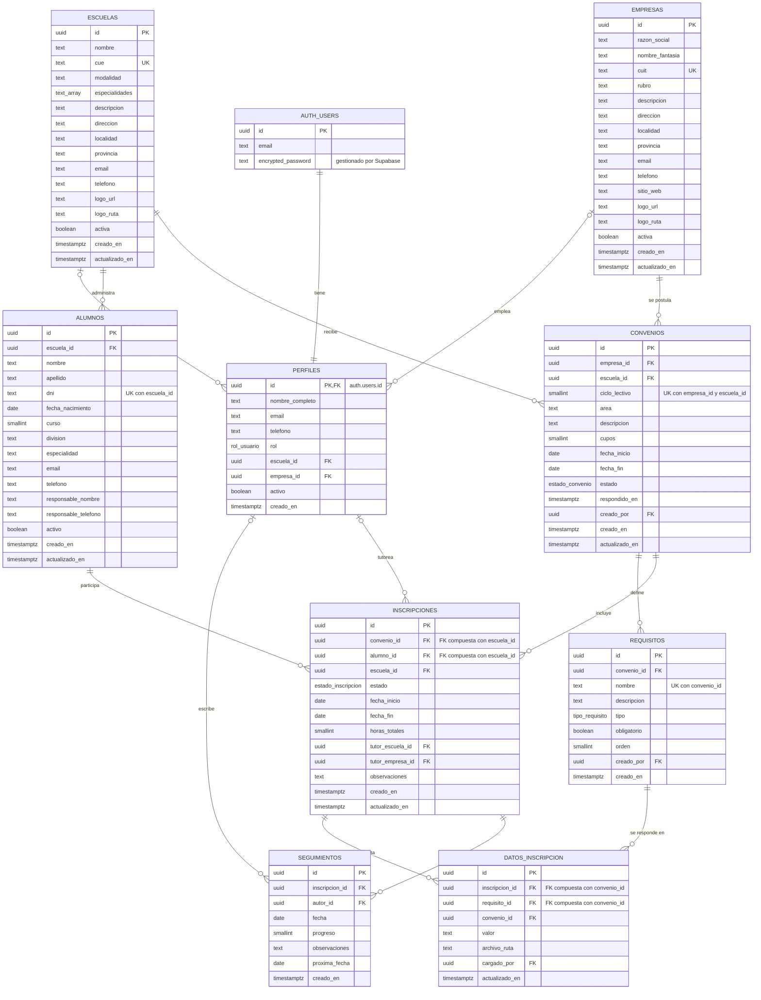

# 02 · Diagrama entidad-relación

Fuente Mermaid (se renderiza en GitHub y VS Code). Imagen exportada: [`der.png`](der.png).

## Relaciones y cardinalidades

| Relación | Cardinalidad | FK | On delete |
|---|---|---|---|
| auth.users → perfiles | 1 : 1 | `perfiles.id` | cascade |
| escuelas → perfiles | 1 : 0..N | `perfiles.escuela_id` | restrict |
| empresas → perfiles | 1 : 0..N | `perfiles.empresa_id` | restrict |
| escuelas → alumnos | 1 : 0..N | `alumnos.escuela_id` | cascade |
| empresas → convenios | 1 : 0..N | `convenios.empresa_id` | cascade |
| escuelas → convenios | 1 : 0..N | `convenios.escuela_id` | cascade |
| escuelas ↔ empresas | N : M | resuelta por `convenios` (UK empresa + escuela + ciclo) | |
| convenios → requisitos | 1 : 0..N | `requisitos.convenio_id` | cascade |
| convenios → inscripciones | 1 : 0..N | `inscripciones (convenio_id, escuela_id)` | cascade |
| alumnos → inscripciones | 1 : 0..N | `inscripciones (alumno_id, escuela_id)` | cascade |
| convenios ↔ alumnos | N : M | resuelta por `inscripciones` (UK convenio + alumno) | |
| inscripciones → datos_inscripcion | 1 : 0..N | `datos_inscripcion (inscripcion_id, convenio_id)` | cascade |
| requisitos → datos_inscripcion | 1 : 0..N | `datos_inscripcion (requisito_id, convenio_id)` | cascade |
| inscripciones ↔ requisitos | N : M | resuelta por `datos_inscripcion` (UK inscripción + requisito) | |
| inscripciones → seguimientos | 1 : 0..N | `seguimientos.inscripcion_id` | cascade |
| perfiles → seguimientos | 0..1 : 0..N | `seguimientos.autor_id` | set null |
| perfiles → inscripciones (tutores) | 0..1 : 0..N | `tutor_escuela_id`, `tutor_empresa_id` | set null |
